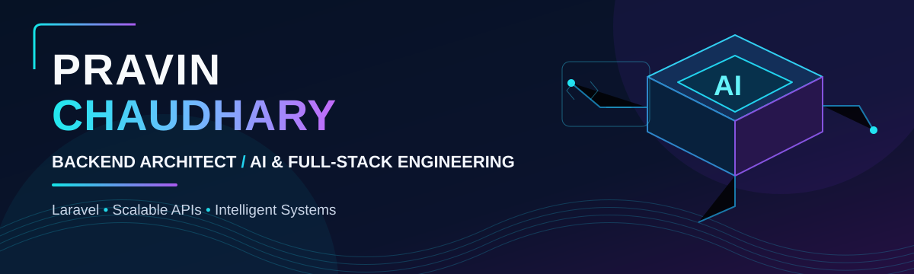

  

**Senior Laravel Developer · Backend & System Architecture · AI & Full-Stack Engineering**

Building reliable APIs, scalable platforms, and practical automation systems.

---

### 👋 About me

I'm **Pravin Chaudhary**, a Laravel-focused backend developer based in Ahmedabad, India, with **4+ years of professional experience** building web applications and API-driven systems.

My core strengths are **backend architecture, performance optimization, multi-tenant systems, integrations, and asynchronous processing**. Alongside this work, I'm expanding into **Python-powered automation, local AI workflows, and React + Laravel product development**.

> I care about maintainable architecture, measurable performance, and software that solves real problems.

### ⚡ Engineering focus

- **Backend & APIs:** Laravel, RESTful APIs, secure integrations, background jobs, and high-concurrency workflows.
- **Systems & scale:** Multi-tenancy, Redis caching, queue workers, webhooks, and event-driven processes.
- **AI & full-stack exploration:** Python automation, local AI experimentation, React interfaces, and connected products.

### 🧰 Technology toolkit

**Backend & application development**

**Databases, infrastructure & tools**

**Currently building with / exploring**

### 🏗️ Selected professional work

These are **professional project highlights**, not claims that the underlying company code is open source. The descriptions are intentionally high level.

| Project | Area | Highlights |
| :--- | :--- | :--- |
| **Epsilon** | Logistics ERP | Tile-export management workflows, role-based access control, and operational automation. |
| **Eatcard** | Restaurant technology | Multi-branch ordering workflows and third-party delivery integrations. |
| **Syncio** | Integration platform | Multi-tenant Laravel services, webhooks, and queue processing with Laravel Horizon. |

### 🧪 What I'm building next

*Work in progress — private development / exploration; no public demo or production deployment implied.*

- **HomeVerse 3D** — planning a React + Laravel experience around interactive 3D home design and an editor-focused workflow.
- **AI-assisted research & paper-trading lab** — exploring Python services, real-time market data, MongoDB, and local AI-assisted analysis in a **simulation-only** environment. Live-money trading is **not** enabled.

### 📈 Engineering outcomes

- **Up to 40% faster API responses** through query improvements and Redis caching *(self-reported result)*.
- Contributed to the delivery of **5+ scalable applications** with demanding backend workflows.
- Integrated payment and commerce services, including **Adyen, Mollie, Shopify, and WooCommerce**.
- Supported junior developers and contributed to system architecture decisions.

<strong>📊 GitHub activity</strong>

 

  

<em>Public repositories are only a partial view of engineering work; statistics are supplied by an external service.</em>

---

**Let's build scalable systems and thoughtful software.**

[LinkedIn](https://www.linkedin.com/in/pravinchaudharyofficial/) · [Email](mailto:chaudharypravinbhai944@gmail.com) · [GitHub](https://github.com/pravin99c)

